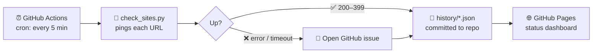

<div align="center">




<p>


</p>
<p>


</p>

**[🌐 Live dashboard](https://hemashreevi.github.io/pulse/)** · **[⚡ Quick start](#-quick-start)** · **[🧭 How it works](#-how-it-works)** · **[🗺️ Roadmap](#%EF%B8%8F-roadmap)**

</div>

---

## 💡 Why Pulse?

Uptime monitors usually mean paying for a SaaS plan or running a server that watches your other servers. **Pulse uses GitHub as the infrastructure.**

- 🕔 **GitHub Actions** is the scheduler that pings your sites.
- 🗃️ **The repo itself** is the database, because every check is committed as history.
- 🌐 **GitHub Pages** hosts the live status dashboard.
- 🚨 **GitHub Issues** is the alerting system.

> **Zero servers, zero cost, zero dependencies.** If GitHub is up, your monitor is up.

## ✨ Features

<table>
<tr>
<td width="33%" align="center">🟢<br/><b>Live status</b><br/><sub>Up or down for every site, with HTTP code and response time</sub></td>
<td width="33%" align="center">📈<br/><b>Response-time charts</b><br/><sub>See when your site gets slow, not just when it dies</sub></td>
<td width="33%" align="center">📊<br/><b>90-day uptime bars</b><br/><sub>The classic status-page history strip, per site</sub></td>
</tr>
<tr>
<td align="center">🚨<br/><b>Auto incidents</b><br/><sub>Opens a GitHub issue on failure and closes it on recovery</sub></td>
<td align="center">🧾<br/><b>One config file</b><br/><sub>Add a site = add one line to <code>sites.json</code></sub></td>
<td align="center">🍴<br/><b>Fork-and-go</b><br/><sub>Your own status page in about 2 minutes</sub></td>
</tr>
</table>

## 🧭 How it works



| Step | What happens |
|:-:|---|
| **1** | A scheduled workflow wakes up every 5 minutes. |
| **2** | `check_sites.py` sends one request to every URL in `sites.json` and times the answer. |
| **3** | The result (status code, milliseconds, up/down) is appended to that site's history file and committed. |
| **4** | If a site fails, an issue is opened automatically. When it recovers, the issue is closed with the downtime duration. |
| **5** | The dashboard on GitHub Pages reads the history files and draws the charts. |

## 🎬 Demo

> 🛠️ *A dashboard GIF and the live link go here once step 4 is built.*

```text
Pulse - checking 4 sites

STATUS  CODE       TIME   NAME
----------------------------------------------------
UP      200       142 ms   My portfolio
UP      200        96 ms   GitHub
UP      200        71 ms   Google
DOWN    404       298 ms   Broken page  (Not Found)
----------------------------------------------------
3/4 sites up
```

## ⚡ Quick start

```bash
# 1. Fork this repo, then clone your fork
git clone https://github.com/<you>/pulse.git
cd pulse

# 2. Add your sites
#    edit sites.json → { "name": "My site", "url": "https://example.com" }

# 3. Try a check locally (no installs needed)
python check_sites.py
```

Then in your fork:
1. Go to **Settings → Pages** and deploy from the `main` branch.
2. Go to the **Actions** tab and enable workflows.
3. Wait 5 minutes and open your status page. 🎉

## 🗂️ Project structure

```
pulse/
├── check_sites.py          # pings every site, records results
├── sites.json              # the list of sites to watch
├── history/                # one JSON file of results per site (auto-committed)
├── index.html              # the status dashboard (GitHub Pages)
└── .github/workflows/
    └── pulse.yml           # runs the check every 5 minutes
```

## 🗺️ Roadmap

- [x] **Step 1:** Checker script with status code and response time
- [ ] **Step 2:** GitHub Actions workflow on a 5-minute schedule
- [ ] **Step 3:** Save results as history and commit them automatically
- [ ] **Step 4:** Live dashboard with charts and 90-day uptime bars
- [ ] **Step 5:** Automatic incident issues on downtime and recovery
- [ ] *Stretch:* response-time alerts, badges for your own README, email notifications

## 🧰 Built with

<p align="center"></p>

---

<div align="center">

**Built by [Hemashree V I](https://hemashreevi.github.io)** · B.Tech CSE (Cyber Physical Systems), VIT Chennai

<a href="https://hemashreevi.github.io"></a>
<a href="https://www.linkedin.com/in/hema-shree-373622289"></a>
<a href="mailto:shreejith2005@gmail.com"></a>

<sub>⭐ If Pulse keeps your site alive, a star keeps this repo alive.</sub>

</div>
